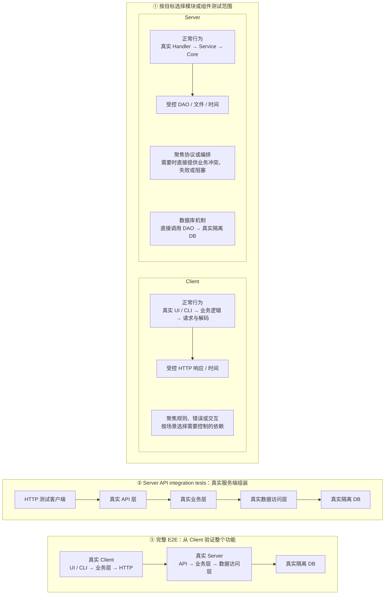

# Client/Server 测试范围示例

Client 和 Server 按行为组织模块或组件测试，在生产依赖方向内保留轻量、确定的真实协作者，需要时控制外部能力、错误或时序。Server API 集成验证完整服务端链路，最终从真实 Client 发起 E2E。

第一组展示可选择的测试范围，每个场景独立准备状态；图中实线箭头表示实际调用，受控依赖在相应边界提供结果。源码分层不要求每层都有相同的 mock 边界。

例如生产关系是 `Service → Store → DB`。要验证 `Store.Rename` 是否持久化了新名称：

| 准备 → 执行 → 读回 | 判断 |
|---|---|
| 用 SQL fixture 插入旧记录 → 调用 `store.Rename` → 查询隔离数据库中的名称 | 合法。直接触发 Store 的写入，并观察提交后的结果。 |
| 调用 `service.Create` → 调用 `store.Rename` → 用 `service.Get` 断言名称 | 反向依赖。即使中间写入正确，Service 的创建校验或读取过滤变化也能让测试失败。把首尾藏进 `givenRecord()`、`assertRecord()` 仍是同一个问题。 |

如果目标改为「无权限的调用者不能重命名」，就从负责授权的业务入口测试拒绝行为。各层的其他验证同理：

- Client 正常行为测试控制 HTTP 响应，真实运行请求构造、解码、业务处理与呈现；错误或时序专项按需要控制相应能力。
- Server 正常行为测试可以控制 DAO，保留真实 Handler、Service 和 Core；测试 HTTP 409 映射时，可以直接让 Service 返回冲突。权限拒绝不进入业务、取消后退出等保证，观察其实际负责的边界。
- 业务模块拥有完整规则矩阵；DAO 测试连接真实 DB，证明 SQL、事务、并发和持久化等机制。
- Server API 集成通过 HTTP 创建、读取、修改并读回同一记录，证明真实服务端链路。
- 完整 E2E 操作真实 Client 创建记录、查看并修改状态，再由 Client 重新读取，核对记录身份、内容和状态，证明完整功能。
